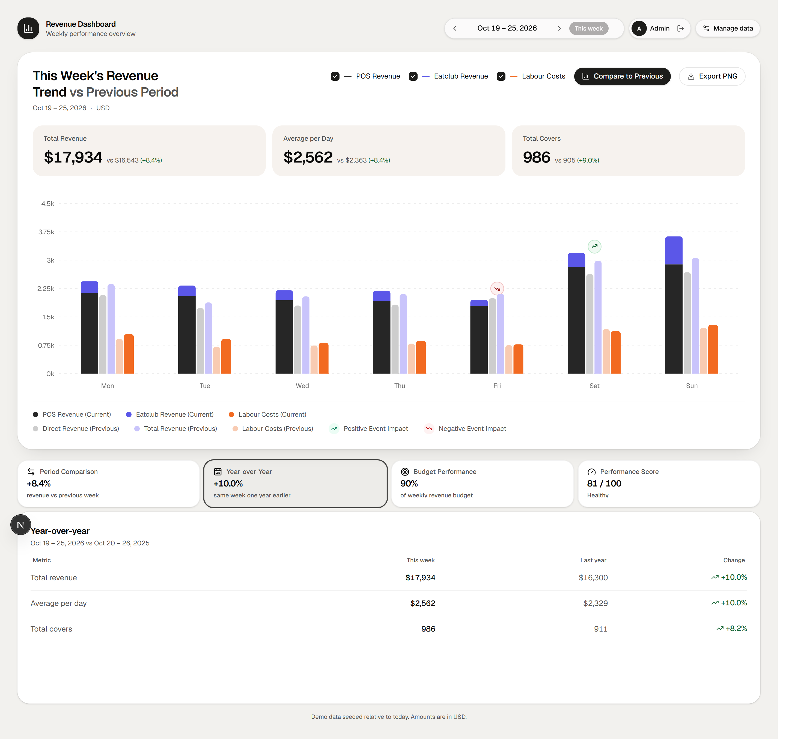

# Revenue Dashboard

A weekly revenue dashboard for a restaurant group, built for a coding challenge. It reads data from a PostgreSQL database through an Express API and renders it in a Next.js app, with admin screens for changing the numbers.

The code lives in two repositories:

- **API**: [flourine95/revenue-dashboard-api](https://github.com/flourine95/revenue-dashboard-api)
- **UI**: [flourine95/revenue-dashboard-ui](https://github.com/flourine95/revenue-dashboard-ui)

The dashboard shows revenue, covers and labour for one week next to the week before. Three more tabs compare the same week last year, track the weekly budget and score the week. Annotations on the chart are events the admin creates.





An interactive diagram of how the three processes fit together is at **[flourine95.github.io/revenue-dashboard/architecture.html](https://flourine95.github.io/revenue-dashboard/architecture.html)**. Every node in it links to the source file it describes.

## Run it

You need three things before you start:

- Node.js 20.19+, 22.12+ or 24+ (22 LTS recommended)
- pnpm 12.11.2, pinned by `packageManager` in both repositories: `corepack enable && corepack prepare pnpm@12.11.2 --activate`
- Docker Desktop on macOS or Windows, or Docker Engine with the Compose plugin on Linux

Start the API first. The UI calls it on port 4000.

```bash
cd revenue-dashboard-api
pnpm install
cp .env.example .env
pnpm db:up
pnpm db:setup
pnpm dev
```

`db:setup` applies the migration, generates the Prisma client and loads about 14 months of demo data. On a fresh machine the whole sequence takes roughly 40 seconds, mostly the dependency install.

Confirm the API is listening:

```bash
curl http://localhost:4000/health
# → {"status":"ok","database":"up"}
```

Leave that terminal running and open a second one:

```bash
cd revenue-dashboard-ui
pnpm install
cp .env.example .env.local
pnpm dev
```

Open http://localhost:3000 and sign in with `admin@revenue.local` and `admin1234`. The seed creates that account.

If the browser reaches the app on a host or port other than `localhost:3000`, set `NEXT_PUBLIC_API_URL` to the API origin and add the browser origin to `CORS_ORIGIN` in the API `.env`. Otherwise the login request is blocked.

<details>
<summary>Windows</summary>

If `pnpm dev` prints nothing and never starts listening, run the entrypoint directly with `npx tsx src/index.ts` in the API repository.

</details>

## What it does

| Surface | URL |
| --- | --- |
| Dashboard | http://localhost:3000 |
| Admin | http://localhost:3000/admin |
| API health | http://localhost:4000/health |

The dashboard covers a week at a time, with arrows for the week before and after and a control that returns to the current week. Each series (POS revenue, Eatclub revenue, labour cost) can be toggled off. The y-axis holds a 0.75k grid so two weeks can be compared by eye, and the export button saves the card as a PNG.

The admin screens at `/admin` edit one day of metrics at a time and manage the events that appear on the chart. Both routes check the session on the server and send anonymous visitors to `/login`.

## How the pieces fit

```text
Browser
  │  httpOnly session cookie
  ▼
Next.js 16 (port 3000) ──▶ Express 5 API (port 4000) ──▶ PostgreSQL 17 (port 5432)
```

[architecture.html](architecture.html) draws the same system with the trust boundary, the two paths out of the browser and the tables behind the API. Read it live at [flourine95.github.io/revenue-dashboard/architecture.html](https://flourine95.github.io/revenue-dashboard/architecture.html); GitHub shows this file as source, not as a page.

Each application is its own repository:

| Repository | Responsibility | Stack |
| --- | --- | --- |
| [revenue-dashboard-api](https://github.com/flourine95/revenue-dashboard-api) | REST API, session auth, dashboard aggregation, admin CRUD | Express 5, Prisma 7, Zod, PostgreSQL |
| [revenue-dashboard-ui](https://github.com/flourine95/revenue-dashboard-ui) | Dashboard, insight tabs, login, admin screens, PNG export | Next.js 16, React 19, Tailwind 4, shadcn/ui, Recharts |

Setup, schema, endpoints and environment variables are in the [API README](https://github.com/flourine95/revenue-dashboard-api#setup). Setup, routes and components are in the [UI README](https://github.com/flourine95/revenue-dashboard-ui#setup).

## Tests

Run these in each repository:

| Repository | Command | Covers |
| --- | --- | --- |
| API | `pnpm test` | Period and KPI maths, plus every endpoint against a throwaway PostgreSQL database |
| API | `pnpm typecheck` | TypeScript |
| UI | `pnpm test` | Date ranges, formatting, performance score, chart series join and axis scale |
| UI | `pnpm typecheck` | TypeScript |
| UI | `pnpm lint` | ESLint |
| Both | `pnpm build` | Production build |

Current results: 43 API tests and 22 UI tests pass, and both builds succeed. Neither repository ships a browser test suite; login, navigation, admin CRUD and export were checked by hand in a browser.

## Decisions worth explaining

**Sessions, not JWTs.** The API stores a SHA-256 hash of an opaque token and sends the token itself in an httpOnly cookie. Logging out deletes the row, so a session stops working the moment it is revoked.

**The comparison period always travels with the dashboard.** Toggling "Compare to Previous" changes what the chart draws, not what the API returns. The toggle costs no request, and nothing on the page moves.

**Hidden labels keep their space.** Comparison text, the previous-period legend, the current-week control and the export label reserve their room whether or not they are visible, so pressing a control does not reflow the card.

**The score weights revenue first.** Revenue against budget is 50% of the score, labour efficiency 30% and covers momentum 20%. The formula is in `lib/score.ts` with unit tests.

**Year-over-year loads late.** The dashboard request stays small; the year-over-year endpoint runs only when someone opens that tab.

## Known gaps

- The selected week and the open tab are not in the URL, so a reload returns to the current week.
- The chart has a text summary for screen readers but no full data table.
- The API allows one CORS origin, which is enough to run locally.
- Failed sign-in counters live in memory and reset when the API restarts. A lockout does not survive a restart or carry across several API instances.
- A visitor in a negative-offset timezone can see the previous week just after midnight on Monday, because the API resolves weeks in UTC.
- Demo credentials and seeded data are for local use.
- The interface is English only.
