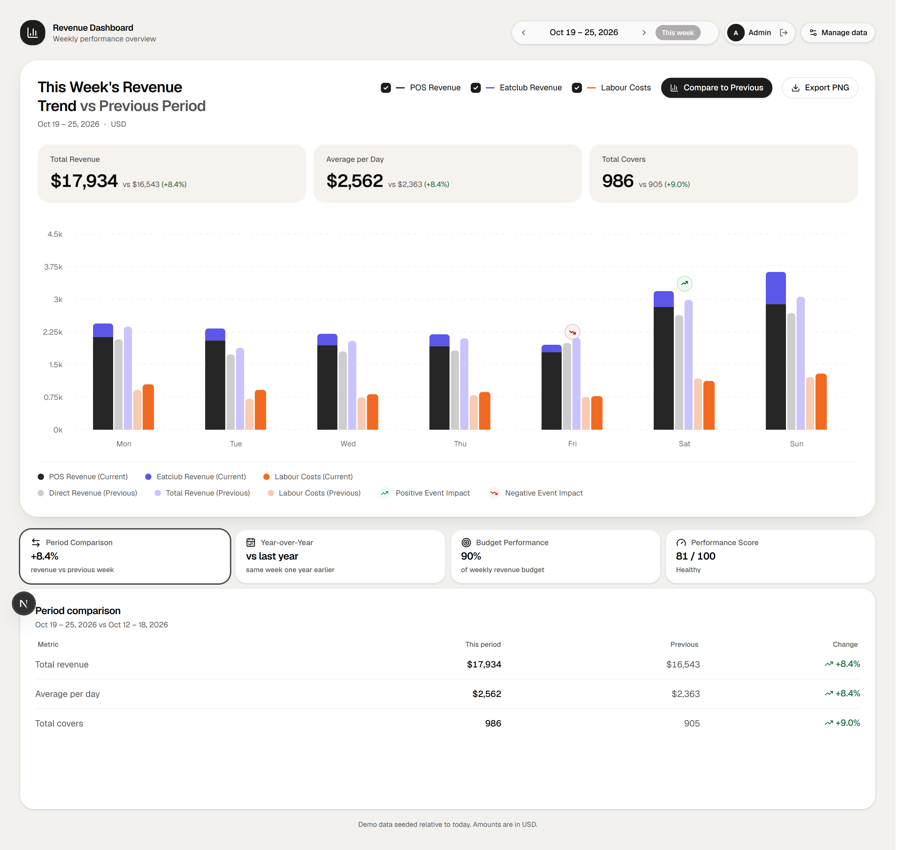
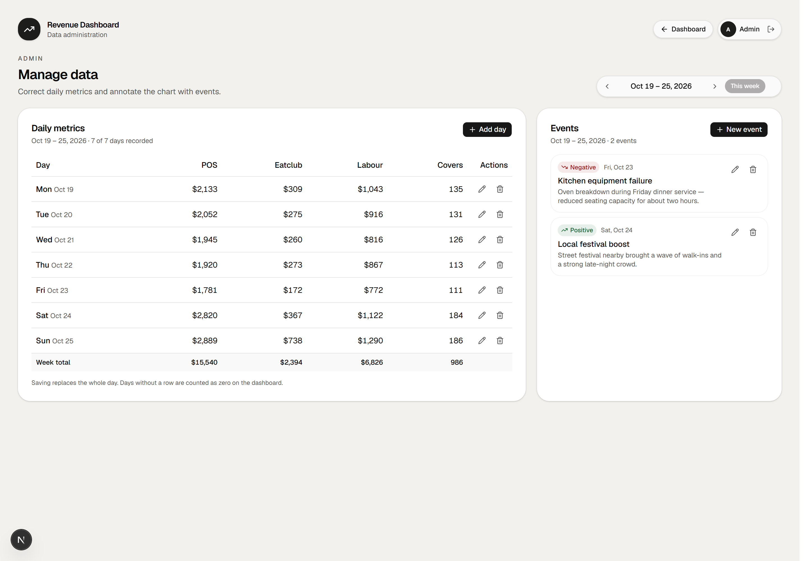

# Revenue Dashboard

A weekly revenue dashboard for a restaurant group. The project has an Express API, a Next.js frontend, a seeded PostgreSQL database, and admin screens for editing the numbers behind the chart.

The dashboard shows revenue, covers and labour for the current week against the previous week. It also compares the same week last year, tracks the weekly budget and calculates a performance score. Every chart annotation comes from an event the admin team can create, edit or delete.

## Demo

| Surface    | URL                          |
| ---------- | ---------------------------- |
| Dashboard  | http://localhost:3000        |
| Admin      | http://localhost:3000/admin  |
| API health | http://localhost:4000/health |

Sign in with `admin@revenue.local` and `admin1234`. The API seed creates this account and about 14 months of demo data.

## Screenshots





## Architecture

Two applications run side by side:

```text
Browser
  │  httpOnly session cookie
  ▼
Next.js 16 (port 3000) ──▶ Express 5 API (port 4000) ──▶ PostgreSQL 17 (port 5432)
```

| Application | Responsibility | Stack |
| --- | --- | --- |
| `revenue-dashboard-api` | REST API, session auth, dashboard aggregation, admin CRUD | Express 5, Prisma 7, Zod, PostgreSQL |
| `revenue-dashboard-ui` | Dashboard, insight tabs, login, admin screens, PNG export | Next.js 16, React 19, Tailwind 4, shadcn/ui, Recharts |

## Run locally

Verified end to end on a clean Linux container (Node 22, no global packages) following only the steps below. macOS works the same way; the Windows note under the API is the only platform-specific instruction.

### Prerequisites

- Node.js 20.19 or newer, 22.12+ or 24+ (22 LTS recommended)
- pnpm, activated through Corepack: `corepack enable && corepack prepare pnpm@12.11.2 --activate`
- Docker Desktop (macOS/Windows) or Docker Engine with the Compose plugin (Linux)

### Start the API

```bash
cd revenue-dashboard-api
pnpm install
cp .env.example .env
pnpm db:up
pnpm db:setup
pnpm dev
```

`db:setup` applies the migration, generates the Prisma client and loads the demo data. The API listens on port 4000. On a clean machine this takes about 40 seconds including the dependency install.

Check it is up:

```bash
curl http://localhost:4000/health
# → {"status":"ok","database":"up"}
```

<details>
<summary>Windows note</summary>

If `pnpm dev` prints nothing and does not listen, run the entrypoint directly: `npx tsx src/index.ts`.

</details>

### Start the UI

Open a second terminal:

```bash
cd revenue-dashboard-ui
pnpm install
cp .env.example .env.local
pnpm dev
```

Open http://localhost:3000 and sign in with the demo account.

If the browser runs on another host or port, set `NEXT_PUBLIC_API_URL` to the API origin and update `CORS_ORIGIN` in the API environment.

## Tests and checks

| Command | Scope | Current result |
| --- | --- | --- |
| `pnpm test` | API unit and endpoint tests, including a throwaway PostgreSQL database | 40 passing |
| `pnpm test` | UI unit tests for formatting, week ranges, score, chart data and chart scale | 22 passing |
| `pnpm typecheck` | TypeScript, both applications | passing |
| `pnpm lint` | ESLint, UI application | passing |
| `pnpm build` | Production build, both applications | passing |

The repository does not include a browser end-to-end suite. I checked login, week navigation, the four insight tabs, admin CRUD, guards and PNG export with Playwright during development, but those scripts live outside the two application repositories.

## Working with AI

[`docs/ai-usage.md`](docs/ai-usage.md) describes how the project was built with AI assistance: the process, which parts were mine, and the concrete problems that review and verification caught.

## Features

- Weekly dashboard with previous-period comparison, per-series toggles, event markers and a PNG export.
- Insight tabs for period comparison, year-over-year, budget performance and a composite performance score.
- Admin screen for daily metrics and events, including create, edit, delete and confirmation dialogs.
- Server-side session auth with an httpOnly cookie and hashed session tokens.
- Responsive layout with a light theme by default and a dark theme on the `d` key.

## Design decisions

### Server sessions over JWT

The API stores a SHA-256 hash of an opaque token and sends the raw token in an httpOnly cookie. Logout deletes the row, so revocation is immediate.

### Comparison data is always fetched

Toggling “Compare to Previous” only changes what the dashboard renders. The previous period is already in the payload, so the toggle does not trigger a request or change the layout.

### Reserved space prevents layout shift

Comparison text, previous-period legend entries, the “This week” control and the export label keep their space when hidden. The dashboard does not move when a control is pressed.

### Performance score

Revenue against budget is 50% of the score, labour efficiency is 30% and covers momentum is 20%. The formula lives in `revenue-dashboard-ui/lib/score.ts` and has unit tests.

### Year-over-year is lazy

The dashboard request stays small. The year-over-year endpoint runs only when the visitor opens that tab.

## Project layout

```text
revenue-dashboard/
  docs/
    ai-usage.md           How AI assistance was used and verified
    reference/            Design reference images
    screenshots/          Screenshots used in this README
  revenue-dashboard-api/  Express API and Prisma schema
  revenue-dashboard-ui/   Next.js application
```

Each application is its own git repository and is ignored by the root one. `.agents/skills/` inside the API holds the three Prisma reference skills this codebase uses; unrelated ones were removed.

## Known gaps

- The selected week and active insight tab are not stored in the URL, so a reload returns to the current week.
- The chart has a text summary for assistive technology but no full data table.
- The API allows one CORS origin, which is enough for local development.
- Login lockout counters live in memory, so they reset when the API restarts; a multi-instance deployment would keep them in Redis.
- The API resolves weeks in UTC, so a visitor in a negative-offset timezone can see the previous week just after midnight on Monday.
- Demo credentials and seeded data are for local use only.
- The interface is English-only.

## Where to read next

- API setup, schema, endpoints and environment variables: [`revenue-dashboard-api/README.md`](revenue-dashboard-api/README.md)
- UI setup, routes, components and scripts: [`revenue-dashboard-ui/README.md`](revenue-dashboard-ui/README.md)
- AI-assisted workflow and verification: [`docs/ai-usage.md`](docs/ai-usage.md)
